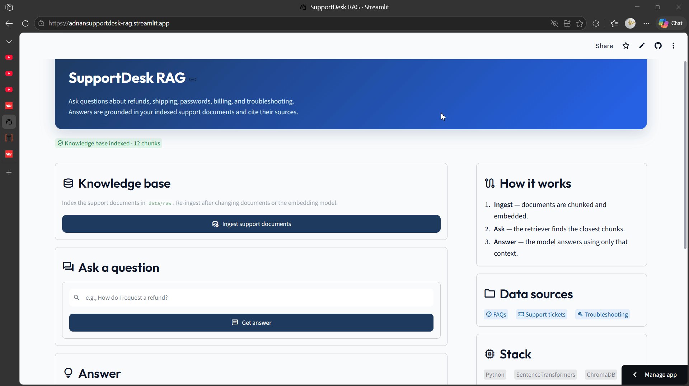
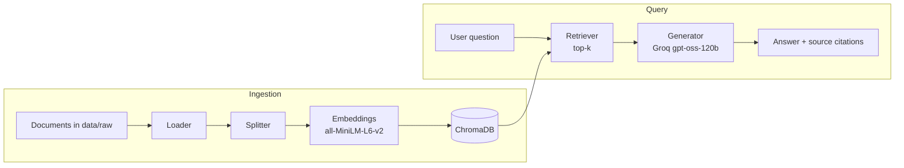

<p align="center">
  
</p>

<!-- Demo slot: upload a screenshot or screen recording to docs/demo.gif (or change the path above). -->

# SupportDesk RAG

Customer support answers grounded in your own documents, with cited sources.


## Overview

SupportDesk RAG is an end-to-end retrieval-augmented generation (RAG) assistant for
customer support. It loads support documents (FAQs, tickets, troubleshooting guides),
chunks and embeds them, stores the vectors in ChromaDB, retrieves the most relevant
chunks for a question, and generates a grounded answer with Groq. Every answer lists
the documents it was built from.

If no Groq API key is configured, the pipeline falls back to a deterministic
answer assembled from the retrieved context, so the project still works offline.

## Features

- Complete RAG pipeline: loading, chunking, embeddings, vector search, retrieval, and generation.
- Supports `.txt`, `.md`, and `.pdf` source documents.
- Local persistent vector store with ChromaDB.
- SentenceTransformers embeddings (`all-MiniLM-L6-v2`) running locally.
- Groq generation with a no-key template fallback.
- Streamlit chat-style UI with ingestion status, answer history, and source badges.
- CLI entrypoint for quick testing.
- Re-ingesting rebuilds the collection, so removed or edited documents are reflected.

## Architecture



## Tech stack

| Layer | Technology |
|-------|------------|
| UI | Streamlit |
| Orchestration | Custom Python pipeline |
| Embeddings | SentenceTransformers (`all-MiniLM-L6-v2`) |
| Vector store | ChromaDB (persistent, local) |
| LLM | Groq (`openai/gpt-oss-120b`) |
| Document parsing | pypdf, plain text, Markdown |
| Environment | uv, Python 3.12 |

## Getting started

### Prerequisites

- Python 3.12+
- [uv](https://docs.astral.sh/uv/)
- A Groq API key (optional, but recommended for natural-language answers)

### 1. Clone and install

```powershell
git clone https://github.com/mohdadnan001/supportdesk-rag.git
cd supportdesk-rag
uv sync
```

### 2. Configure the environment

```powershell
cd rag_pipeline/rag_pipeline
copy .env.example .env
```

Open `.env` and add your key:

```dotenv
GROQ_API_KEY=gsk_your_actual_key_here
```

Get a key at https://console.groq.com/keys. The key is optional; without it the
generator uses its template fallback.

### 3. Run the Streamlit app

```powershell
uv run streamlit run app.py
```

Open http://localhost:8501, click **Ingest support documents**, then ask a question.

### 4. Or use the CLI

```powershell
uv run python main.py
```

The CLI ingests `data/raw`, prompts for a question, and prints the answer and sources.

## Usage

1. Add your documents to `rag_pipeline/rag_pipeline/data/raw/` (`.txt`, `.md`, `.pdf`).
2. Start the app from `rag_pipeline/rag_pipeline/`.
3. Click **Ingest support documents** to rebuild the vector store.
4. Type a question and press Enter.
5. Review the answer and its cited source documents.

Example questions:

- How do I request a refund?
- How long does shipping take?
- How do I reset my password?
- Why was I charged twice?
- My app keeps crashing. What should I check?

## Deploy on Streamlit Community Cloud

1. Push this repository to GitHub.
2. Go to [share.streamlit.io](https://share.streamlit.io), create a new app, and select
   this repository with entrypoint `rag_pipeline/rag_pipeline/app.py`.
3. In **Advanced settings**, choose Python 3.12 (recommended) and add your secret:

   ```toml
   GROQ_API_KEY = "gsk_your_actual_key_here"
   ```

4. Deploy. The app reads `GROQ_API_KEY` from Streamlit secrets, so no `.env` file is needed.
   The Cloud filesystem is ephemeral, so re-ingest after a reboot.

## Configuration

Settings are read from environment variables (see `.env.example`).

| Variable | Default | Description |
|----------|---------|-------------|
| `EMBEDDING_MODEL` | `all-MiniLM-L6-v2` | SentenceTransformers model |
| `CHUNK_SIZE` | `500` | Characters per chunk |
| `CHUNK_OVERLAP` | `50` | Overlap between chunks |
| `TOP_K` | `3` | Chunks retrieved per question |
| `COLLECTION_NAME` | `rag_documents` | ChromaDB collection name |
| `VECTOR_DB_PATH` | `<project>/data/processed/chroma_db` | Local vector store path |
| `GROQ_API_KEY` | unset | Enables Groq generation (or set as a Streamlit secret) |

## Project structure

```text
.
├── docs/                          # Demo assets (add docs/demo.gif here)
├── rag_pipeline/rag_pipeline/
│   ├── app.py                     # Streamlit UI
│   ├── main.py                    # CLI entrypoint
│   ├── config/settings.py         # Environment-backed settings
│   ├── src/rag_pipeline/
│   │   ├── loader.py              # Loads txt, md, pdf from data/raw
│   │   ├── splitter.py            # Chunking with overlap
│   │   ├── embeddings.py          # SentenceTransformers wrapper
│   │   ├── vectorstore.py         # ChromaDB client and collection
│   │   ├── retriever.py           # Top-k semantic retrieval
│   │   ├── generator.py           # Groq generation + template fallback
│   │   └── pipeline.py            # End-to-end orchestration
│   ├── data/raw/                  # Support documents
│   ├── .streamlit/config.toml     # Theme
│   ├── .env.example
│   └── pyproject.toml
├── pyproject.toml                 # uv workspace root
├── uv.lock
├── LICENSE
└── README.md
```

## How it works

1. **Load** — every supported file in `data/raw` is read into memory.
2. **Split** — documents are split into overlapping chunks (500 characters by default).
3. **Embed** — each chunk is encoded with `all-MiniLM-L6-v2`.
4. **Store** — embeddings, text, and metadata are persisted in ChromaDB.
5. **Retrieve** — the question is embedded and the top-k nearest chunks are fetched.
6. **Generate** — retrieved chunks are passed to Groq as context; the answer cites sources.
   Without a Groq key, the generator returns a template-based answer built from the same context.

Each ingest deletes and recreates the collection, so re-running it always reflects
the current contents of `data/raw`.

## Notes

- Run commands from `rag_pipeline/rag_pipeline/`. The vector store defaults to an absolute
  path inside the project; a relative `VECTOR_DB_PATH` override resolves against the current
  working directory.
- If you change the embedding model, delete `data/processed/chroma_db` before re-ingesting.
- `.env` and `data/processed/` are gitignored; never commit your API key.
- There is no OpenAI dependency; generation uses the `groq` package.

## License

Released under the [MIT License](LICENSE).
